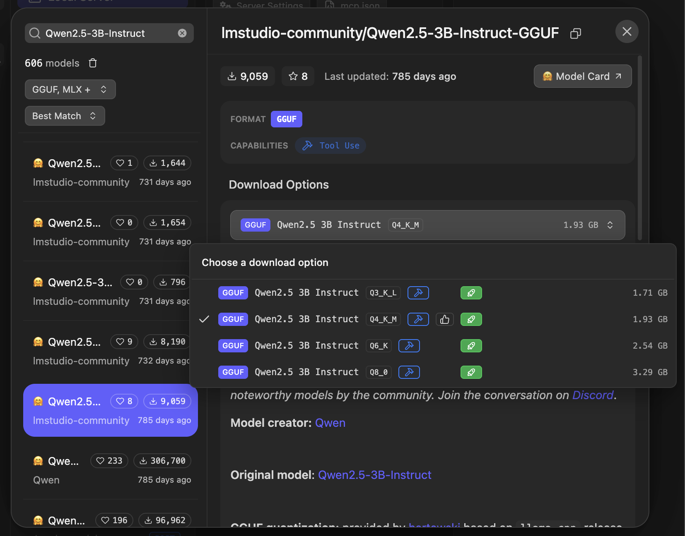
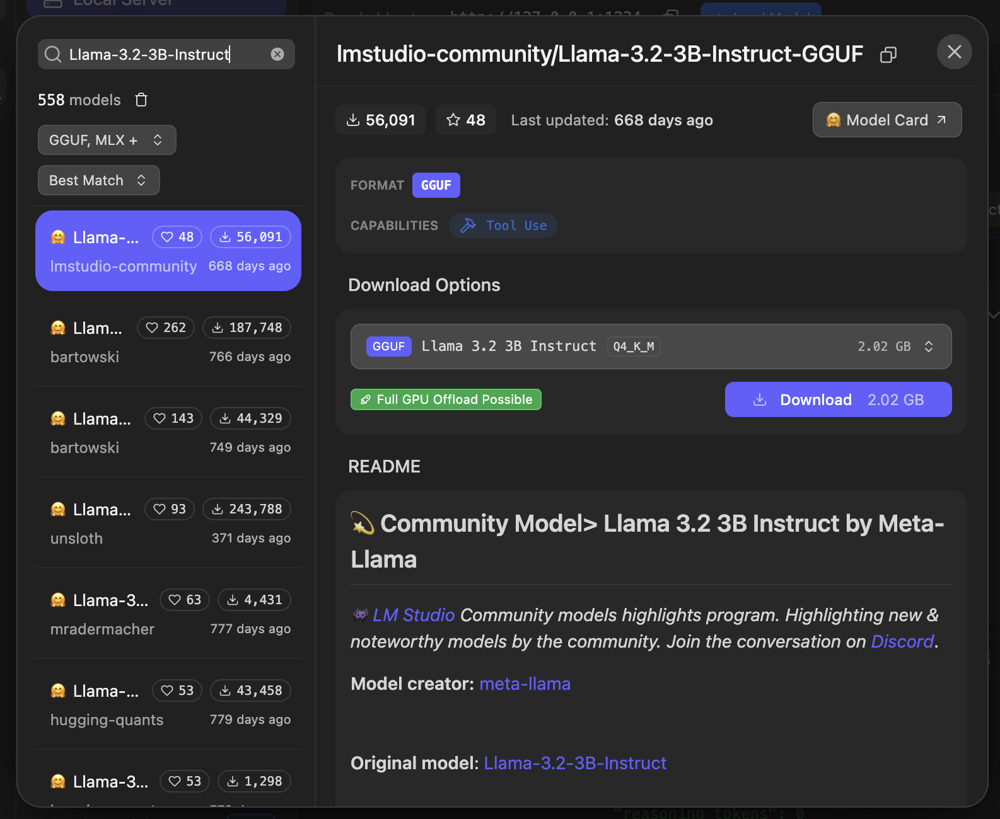

# Local SLM Setup

This project uses LM Studio to run small language models locally.

## Models

We use two instruction-tuned models:

- **Qwen 2.5 3B Instruct** - GGUF, Q4_K_M
- **Llama 3.2 3B Instruct** - GGUF, Q4_K_M

Both models run locally, without requiring an external API key.

## Model Configurations

### Qwen 2.5 3B Instruct



### Llama 3.2 3B Instruct



## Setup

1. Install LM Studio.
2. Download both models in GGUF format (Q4_K_M).
3. Open **Developer → Local Server**.
4. Load the model you want to use.
5. Start the local server on port `1234`.

Verify that the server is running:

```bash
curl http://localhost:1234/v1/models
```

## Python Dependencies

Install the project dependencies:

```bash
pip install -r requirements.txt
```

## Running the Demo

To test Qwen:

```bash
python src/models/slm_demo.py qwen2.5-3b-instruct
```

To test Llama:

```bash
python src/models/slm_demo.py llama-3.2-3b-instruct
```

If no model is specified, the script uses Qwen by default.

The script sends a simple travel-planning request to the selected model and prints its response.

## Notes

- LM Studio must be running when executing the script.
- The selected model must be available through the local server.
- Model files are stored locally and are not committed to GitHub.
- The demo uses the models' general knowledge. Integration with our place dataset, RAG, and itinerary validation will be implemented in later weeks.